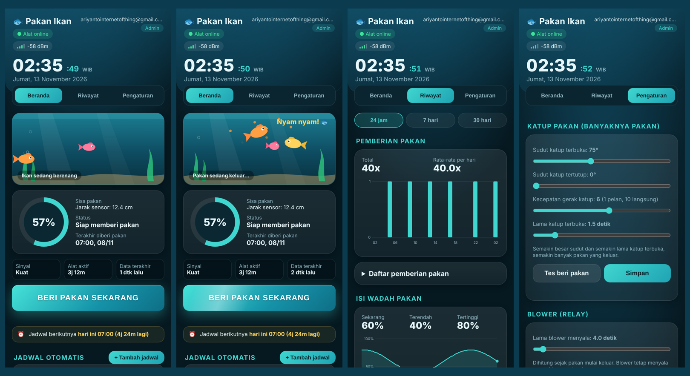
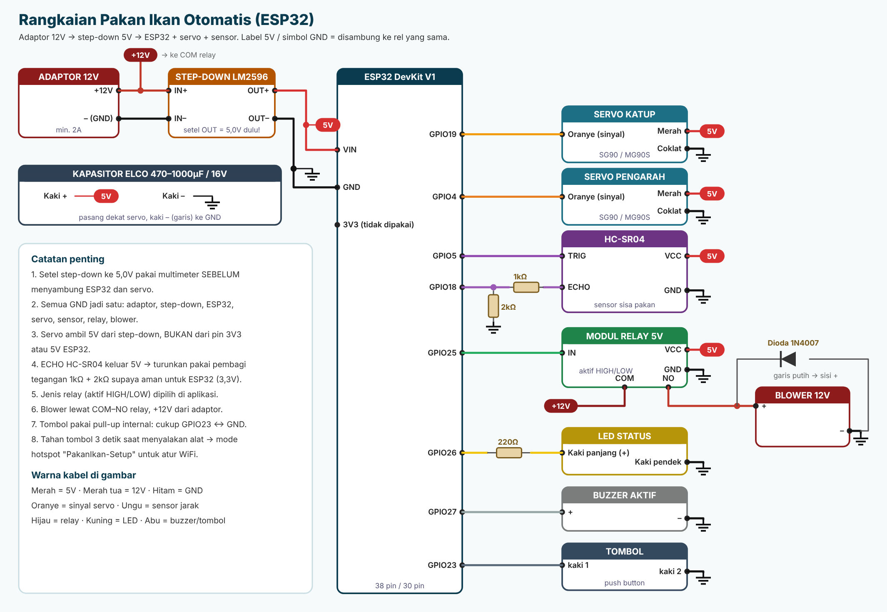

<p align="center">
  
</p>

<h1 align="center">Pakan Ikan Otomatis (ESP32 + Firebase)</h1>

<p align="center">
  Alat pemberi pakan ikan berbasis ESP32 yang dikendalikan dari aplikasi Android buatan sendiri.<br>
  Jadwal, kalibrasi, WiFi, dan semua pengaturan tersimpan di EEPROM alat, jadi tetap jalan walau internet putus.
</p>

<p align="center">
  
  
  
  
</p>



## Unduh aplikasi

APK dibuat otomatis oleh GitHub Actions setiap ada perubahan di folder `aplikasi/`.
Buka **[Releases](../../releases/latest)** lalu unduh **PakanIkan.apk**.

## Fitur

**Alat (ESP32)**
- Beri pakan dari aplikasi, dari jadwal, atau dari tombol fisik
- Jadwal tanpa batas jumlah, pilih hari per jadwal, tetap jalan saat offline
- Banyaknya pakan diatur lewat sudut buka, sudut tutup, kecepatan, dan lama buka servo katup
- Servo pengarah dengan batas sudut minimum, maksimum, dan kecepatan
- Blower (relay) dengan lama nyala yang bisa diatur, jenis relay aktif HIGH atau aktif LOW dipilih dari aplikasi, dan tombol tes relay
- Sensor sisa pakan HC-SR04 dengan kalibrasi titik penuh dan titik habis, alarm buzzer saat hampir habis
- Daftar WiFi (tambah/hapus dari aplikasi), pindah otomatis ke WiFi lain yang tersedia saat WiFi aktif putus
- Mode hotspot **PakanIkan-Setup** untuk atur WiFi tanpa internet
- Reboot otomatis terjadwal
- Update firmware dari aplikasi lewat internet (Firebase, tidak perlu satu WiFi) atau lewat WiFi lokal, juga dari PlatformIO
- Semua pengaturan disimpan di EEPROM dengan checksum
- Riwayat saat offline disimpan di flash, dikirim otomatis saat online kembali

**Aplikasi Android**
- Login pengguna, admin bisa menambah pengguna, opsi ingat perangkat
- Jam dan tanggal, status online, kekuatan sinyal, waktu aktif alat
- Animasi ikan menyambar pakan setiap kali pakan keluar
- Riwayat pemberian pakan dan isi wadah dalam bentuk grafik dan daftar (24 jam / 7 hari / 30 hari)
- Ekspor CSV (riwayat pakan, riwayat isi wadah, jadwal, pengaturan)
- Update firmware ESP32 dari HP lewat internet atau WiFi lokal

## Rangkaian



| Perangkat | ESP32 |
|---|---|
| Servo katup pakan | GPIO19 |
| Servo pengarah | GPIO4 |
| HC-SR04 TRIG / ECHO | GPIO5 / GPIO18 (ECHO lewat pembagi 1kΩ + 2kΩ) |
| Relay blower (aktif HIGH atau LOW, dipilih di aplikasi) | GPIO25 |
| LED status (220Ω) | GPIO26 |
| Buzzer aktif | GPIO27 |
| Tombol (ke GND) | GPIO23 |

Detail daya, dioda, kapasitor, dan kesalahan umum: **[docs/PIN_MAPPING.md](docs/PIN_MAPPING.md)**.

## Struktur folder

```
├── README.md
├── .github/workflows/build-apk.yml   pembuat APK otomatis
├── aplikasi/                         aplikasi Android (WebView + jembatan Java)
│   └── app/src/main/assets/config.js konfigurasi Firebase untuk aplikasi
├── firmware/
│   ├── arduino/PakanIkanFirebase/    untuk Arduino IDE
│   │   ├── PakanIkanFirebase.ino
│   │   └── kredensial.contoh.h       salin menjadi kredensial.h lalu isi
│   ├── platformio/                   untuk VS Code + PlatformIO
│   └── wokwi/                        untuk simulator Wokwi
├── firebase/
│   ├── database.rules.json           aturan keamanan database
│   └── firebase_setup.html           halaman bantu pengisian konfigurasi
└── docs/
    ├── PANDUAN_LENGKAP.md            panduan dari nol untuk pemula
    ├── PANDUAN_FITUR_V3.md           fitur v3 (OTA, WiFi, kalibrasi, CSV, dll)
    ├── PIN_MAPPING.md
    ├── gambar/                       ikon, rangkaian
    └── screenshot/
```

## Mulai cepat

1. **Firebase**: buat proyek, Realtime Database, login Email/Password, akun admin dan akun ESP32, lalu pasang `firebase/database.rules.json`. Detail di [PANDUAN_LENGKAP.md](docs/PANDUAN_LENGKAP.md#langkah-1-menyiapkan-firebase).
2. **Firmware**:
   - Arduino IDE: pasang board ESP32 (core 2.0.x) dan library **Firebase Arduino Client Library for ESP8266 and ESP32** (Mobizt) serta **ESP32Servo**.
   - Salin `kredensial.contoh.h` menjadi `kredensial.h`, isi WiFi, akun Firebase, dan password OTA.
   - **Tools > Partition Scheme > Minimal SPIFFS (1.9MB APP with OTA)**, lalu Upload.
3. **Aplikasi**: isi `aplikasi/app/src/main/assets/config.js`, upload ke GitHub, tunggu tab **Actions** selesai, unduh APK dari Releases.

## Keamanan

- `kredensial.h` dan folder `pribadi/` ada di `.gitignore`, jadi password WiFi, akun ESP32, dan OTA **tidak** ikut ke GitHub.
- `config.js` berisi konfigurasi web Firebase yang memang boleh publik. Yang menjaga data adalah **Rules** database dan login.
- Password hotspot setup bawaan `12345678` hanya aktif saat mode setup. Ganti `AP_PASS` di firmware jika perlu.

## Pertanyaan umum

**Apakah jadwal tetap jalan saat alat offline?**
Ya. Jadwal ada di EEPROM dan dicek oleh alat sendiri. Syaratnya jam alat pernah tersinkron dari internet sejak alat dinyalakan. Jika listrik padam lalu alat menyala tanpa internet, jadwal menunggu sampai jam tersinkron. Jika alat sedang sibuk mencari WiFi tepat di jam jadwal, pakan tetap keluar sampai 3 menit terlambat.

**Riwayat saat alat offline berhari-hari tersimpan?**
Ya (firmware v3.6). Setiap pemberian pakan dan catatan isi wadah (tiap 1 jam saat offline) disimpan di memori flash alat, tidak hilang walau listrik padam. Begitu online, semuanya dikirim ke Firebase dengan jam aslinya, dan di aplikasi ditandai "tercatat saat offline". Kapasitas: 60 pemberian pakan terakhir dan 120 catatan isi wadah (5 hari). Jika penuh, catatan tertua yang dibuang.

**Upload firmware gagal "Sketch too big"?**
Pilih partisi **Minimal SPIFFS (1.9MB APP with OTA)**.

**`kredensial.h` belum ada?**
Salin `kredensial.contoh.h` menjadi `kredensial.h` di folder yang sama, lalu isi.

Masalah lain: lihat bagian *Masalah umum* di [PANDUAN_LENGKAP.md](docs/PANDUAN_LENGKAP.md#masalah-umum).
