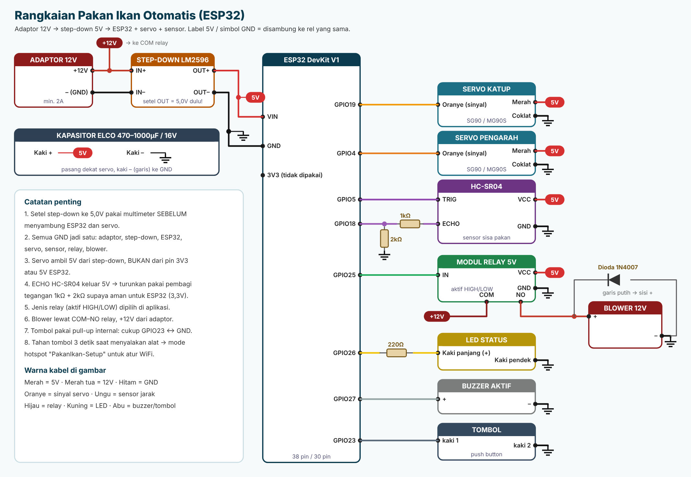

# Pin Mapping & Rangkaian

## Sumber daya

| Dari | Ke | Keterangan |
|---|---|---|
| Adaptor 12V **+** | Step-down LM2596 **IN+** | Adaptor minimal 2A |
| Adaptor 12V **–** | Step-down **IN–** | |
| Adaptor 12V **+** | Relay **COM** | Jalur daya blower |
| Step-down **OUT+ (5,0V)** | ESP32 **VIN**, semua pin **5V** di bawah | Setel 5,0V pakai multimeter **sebelum** menyambung apa pun |
| Step-down **OUT–** | ESP32 **GND**, semua **GND** di bawah | Semua GND jadi satu |
| Kapasitor elco 470–1000µF/16V | Kaki + ke 5V, kaki – (bergaris) ke GND | Pasang dekat servo, mencegah ESP32 restart saat servo bergerak |

## Sinyal ESP32

| Perangkat | Pin perangkat | ESP32 | Daya |
|---|---|---|---|
| Servo katup pakan | Oranye / kuning (sinyal) | **GPIO19** | Merah → 5V, Coklat → GND |
| Servo pengarah | Oranye / kuning (sinyal) | **GPIO4** | Merah → 5V, Coklat → GND |
| HC-SR04 | TRIG | **GPIO5** | VCC → 5V, GND → GND |
| HC-SR04 | ECHO | **GPIO18** lewat pembagi tegangan | ECHO → 1kΩ → GPIO18, lalu GPIO18 → 2kΩ → GND |
| Modul relay 5V (aktif HIGH atau LOW) | IN | **GPIO25** | VCC → 5V, GND → GND |
| LED status | Kaki panjang (+) lewat resistor 220Ω | **GPIO26** | Kaki pendek → GND |
| Buzzer aktif | + | **GPIO27** | – → GND |
| Tombol | Kaki 1 | **GPIO23** | Kaki 2 → GND (pull-up internal, tanpa resistor) |

## Blower (relay)

| Dari | Ke |
|---|---|
| Adaptor 12V **+** | Relay **COM** |
| Relay **NO** | Blower **+** |
| Blower **–** | GND adaptor |
| Dioda 1N4007 | Paralel dengan blower: **garis putih (katoda) ke +**, sisi lain ke – |

Dioda menahan lonjakan tegangan saat motor blower mati. Kalau blower kamu bertegangan 5V, ambil + dari step-down, bukan dari 12V.

## Hal yang sering salah

- **Relay menyala terus saat alat diam, atau tidak menyala saat memberi pakan.** Jenis relay belum cocok. Di aplikasi buka Pengaturan > Blower (Relay), pilih **Aktif LOW** atau **Aktif HIGH**, lalu tekan **Tes relay 3 detik**.
- **Relay bunyi klik tapi blower tidak menyala.** Cek kabel COM dan NO, dan pastikan +12V dari adaptor masuk ke COM.
- **Relay tidak bunyi klik sama sekali di kedua pilihan.** Banyak modul relay 5V butuh sinyal 5V, sedangkan ESP32 hanya 3,3V. Pakai modul relay yang tertulis "3.3V trigger" atau "high/low level trigger", atau tambahkan transistor (misalnya 2N2222 dengan resistor 1kΩ ke basis).
- **ESP32 restart saat servo bergerak.** Servo diberi daya dari pin 5V/3V3 ESP32, atau kapasitor belum dipasang. Servo harus ambil 5V dari step-down.
- **Sisa pakan selalu 0% atau 100%.** Cek pembagi tegangan ECHO dan lakukan kalibrasi titik penuh dan habis di aplikasi.
- **Tombol tidak bereaksi.** Tombol harus menghubungkan GPIO23 ke GND, bukan ke 3V3/5V.

## Tombol fisik

| Aksi | Hasil |
|---|---|
| Tekan sebentar | Beri pakan sekarang |
| Tahan 3 detik saat alat baru dinyalakan | Mode hotspot **PakanIkan-Setup** (password `12345678`), buka `http://192.168.4.1` untuk atur WiFi |
